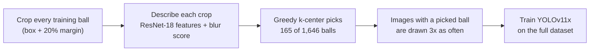

# Fixing Motion-Blur Imbalance in Basketball Detection with Greedy k-Center Coreset Sampling

## Abstract

This study extends my YOLO basketball project, [Basketball-Analytics](https://github.com/infinityvoid1945/Basketball-Analytics).
In that project, the detector often loses the ball mid-flight. The reason is an **intra-class imbalance**: inside the
"ball" class, sharp balls are far more common than motion-blurred balls (only about 22% of the training balls are
blurred), so the model learns what a sharp ball looks like and struggles with a blurred one.

The original project handled this with cost-sensitive learning (punishing the model for missing a ball). This study
asks a different question: can we fix the imbalance **from the data level**, by changing how often the model sees each
training image, without tweaking the model's weights?

The focus is the **greedy k-center coreset** method. It is compared with four common imbalance methods (random
undersampling, SMOTE, repeat factor sampling and focal loss) and an unmodified baseline, all trained the same way on
YOLOv11x. On a held-out game where every ball is blurred, the coreset method raised ball AP50 from 0.756 to 0.827,
second only to repeat factor sampling (0.843). Undersampling was the only method that made things worse.

## The problem: intra-class imbalance

Class imbalance usually means one class has many more examples than another (for example, many players but one ball
per frame). Intra-class imbalance is the same problem *inside one class*: the "ball" class contains two kinds of
balls that look very different.

| | Sharp ball | Blurred ball |
|---|---|---|
| How it looks | round, clear edges | smeared into a streak, faded edges |
| When it happens | dribbling, holding, slow passes | fast passes, shots, quick camera moves |
| Share of training balls | about 68% | about 22% |

Because blurred balls are rare in training, the model sees too few of them, and these are exactly the moments (passes and shots) that matter most for tracking.

## The focus method: greedy k-center coreset

### The k-center problem

Imagine every training ball as a point on a map, where similar-looking balls are close together. The **k-center
problem** asks: pick k points (the "centers") so that every ball on the map is as close as possible to its nearest
center. In other words, choose k balls that **cover every kind of ball** in the dataset:

$$\min_{|S|=k}\ \max_{i}\ \min_{j \in S}\ \lVert x_i - x_j \rVert$$

(S is the set of chosen balls, x<sub>i</sub> is ball i's feature vector.) Solving this exactly is NP-hard, but a simple
greedy algorithm (Gonzalez, 1985) gets within 2x of the best possible answer:

1. Start with one random ball.
2. Find the ball that is **farthest** from every ball chosen so far, and add it.
3. Repeat until k balls are chosen.

It runs in O(n·k·d) time (n balls, k centers, d feature numbers).

### Why it helps with rare balls

Step 2 always picks the ball that is most *different* from everything already chosen. Sharp balls sit close together
in a big crowd, so after a few picks they are already covered. Unusual balls, like blurred streaks, sit far away from
that crowd, so the algorithm keeps picking them. Rare types of balls get selected **without anyone labelling them
as blurred**.

### How it is used in this study



1. **Crop** every ball in the training set, with a 20% margin so the blur streak around the box is included.
2. **Describe** each crop with 512 numbers from a pretrained ResNet-18 (what the ball looks like), plus one extra
   number for blur (the Laplacian variance of the crop: low variance means few sharp edges, so a blurrier ball).
3. **Select** 10% of the balls (165 of 1,646) with greedy k-center.
4. **Upweight**: every training image that contains a selected ball is drawn 3 times as often during training. The
   full dataset is still used; only how often each image appears changes.

The selection worked as intended: 32% of the selected balls are blurred, compared with 22% of all training balls.
Nothing about the YOLO model or its loss is changed.

## The other methods

| Method | What it does | Changes |
|---|---|---|
| Baseline | plain YOLOv11x training | nothing |
| Random undersampling | throws away images that only contain sharp balls until sharp and blurred images are equal (667 of 1,621 images kept) | the data |
| SMOTE | makes new training images by blending a blurred ball with a similar-looking blurred ball from another frame (330 new images) | the data |
| Repeat factor sampling | shows images with a blurred ball about 2x as often (the method from the LVIS dataset paper) | the data |
| Focal loss | changes the loss so that easy examples count less and hard ones (like blurred balls) count more | the loss |

Undersampling, SMOTE and repeat factor sampling need to know which balls are blurred. They use the same automatic blur
score (the 20% of training balls with the lowest Laplacian variance), so no method uses hand labels during training.

## Experiment

| | |
|---|---|
| **Independent variable** | the method used to handle the imbalance (the five methods above, plus the baseline) |
| **Dependent variables** | detection performance: AP50, AP50-95 and recall (overall, on sharp balls and on blurred balls) |
| **Controlled variables** | same detector (YOLOv11x, COCO-pretrained), same training and test data, 100 epochs, 1280 px images, batch 16, SGD optimizer, seed 0, no early stopping, one NVIDIA A100 GPU |

### Data

| Set | Images | Balls | Notes |
|---|---|---|---|
| Training (`rawdata/train`) | 1,621 | 1,646 | broadcast NBA frames, 4 classes: player, ball, rim, backboard |
| Validation (`rawdata/valid`) | 188 | | used to pick the best epoch |
| **Test 1** (`rawdata/test`) | 177 | 179 (138 sharp, 34 blurred, 7 unsure) | same games as training, all 4 classes labelled |
| **Test 2** (`rawdata/moretest`) | 73 | 73 (all blurred) | a separate highlight video never used in training; only balls labelled |

Every ball in `rawdata` was labelled by hand as sharp or blurred (`blur_labels.csv`: `0` = sharp, `1` and `2` =
blurred, `u` = unsure); the test 2 balls were all chosen as blurred balls. These labels are only used to split the
results; no training method sees them.

## Results

### How to read the result files

Each test folder (`results/test1_rawdata`, `results/test2_moretest`) has two files:

* `summary.csv`: one row per trained model
* `summary_by_method.csv`: the average for each method over all training runs. With one run per method, the numbers
  are the same as in `summary.csv`, and the `_std` (standard deviation) columns show `nan` because a spread needs at
  least two runs.

| Column | Meaning |
|---|---|
| `run` / `method` | which model (`baseline_s0` = baseline, seed 0) |
| `mAP50` | AP50 averaged over all four classes (player, ball, rim, backboard) |
| `mAP50-95` | the same, but averaged over stricter overlap thresholds (0.50 to 0.95), so it also rewards tight boxes |
| `ball_AP50` | AP50 for the ball class only. AP (average precision) measures how well the model finds balls without false alarms, from 0 to 1. "50" means a prediction counts as correct if its box overlaps the real box by at least 50% |
| `ball_AP50-95` | ball AP with the stricter thresholds |
| `recall_all` | share of all real balls that the model found (confidence at least 0.25, overlap at least 50%) |
| `recall_sharp` / `recall_blurred` | the same, but only for sharp or only for blurred balls |
| `..._ci95` | 95% confidence interval: the range the true recall is likely in. Small groups give wide ranges |
| `n_all` / `n_sharp` / `n_blurred` | number of balls in each group |

On test 2 every ball is blurred and only balls are labelled, so `mAP50` equals `ball_AP50`, `recall_all` equals
`recall_blurred`, and `recall_sharp` is `nan` (there are no sharp balls to find).

### Test 1: main test set (179 balls: 138 sharp, 34 blurred)

Bold marks the best value in each column.

| Method | mAP50 | mAP50-95 | Ball AP50 | Ball AP50-95 | Recall (all) | Recall (sharp) | Recall (blurred) |
|---|---|---|---|---|---|---|---|
| Baseline | 0.683 | 0.515 | **0.871** | 0.555 | 0.793 | 0.841 | 0.735 (25/34) |
| Greedy k-center coreset (focus) | **0.724** | **0.561** | 0.863 | **0.571** | 0.754 | 0.797 | 0.735 (25/34) |
| Random undersampling | 0.682 | 0.490 | 0.863 | 0.535 | 0.676 | 0.717 | 0.647 (22/34) |
| SMOTE | 0.675 | 0.509 | 0.829 | 0.537 | 0.754 | 0.797 | 0.735 (25/34) |
| Repeat factor sampling | 0.699 | 0.528 | 0.854 | 0.548 | 0.793 | 0.841 | 0.765 (26/34) |
| Focal loss | 0.683 | 0.509 | 0.858 | 0.523 | **0.838** | **0.877** | **0.853 (29/34)** |

### Test 2: held-out game (73 balls, all blurred)

| Method | Ball AP50 | Ball AP50-95 | Recall (blurred) | 95% range |
|---|---|---|---|---|
| Baseline | 0.756 | 0.390 | 0.671 (49/73) | 0.557 to 0.768 |
| Greedy k-center coreset (focus) | 0.827 | 0.417 | 0.712 (52/73) | 0.600 to 0.803 |
| Random undersampling | 0.749 | 0.382 | 0.603 (44/73) | 0.488 to 0.707 |
| SMOTE | 0.824 | 0.417 | 0.712 (52/73) | 0.600 to 0.803 |
| Repeat factor sampling | **0.843** | **0.450** | **0.767 (56/73)** | 0.658 to 0.849 |
| Focal loss | 0.778 | 0.400 | 0.740 (54/73) | 0.629 to 0.827 |

### What the results mean

* **Rebalancing helps on new footage.** On the held-out game, four of the five methods detected blurred balls better
  than the baseline. Only undersampling did worse.
* **Greedy k-center coreset helps, but is not the winner.** It was second on the held-out game (ball AP50 0.756 to
  0.827, and 3 more blurred balls found out of 73) and had the best overall mAP50 and mAP50-95 on the main test set,
  without blur labels and without touching the model or its loss. However, on the main test set it found the same
  number of blurred balls as the baseline (25 of 34) and fewer sharp balls (110 vs 116 of 138).
* **Simple methods did as well or better.** Repeat factor sampling, which just shows blurred-ball images about twice
  as often, was best on the held-out game. Focal loss found the most blurred balls on the main test set (29 of 34).
* **Throwing data away hurts.** Undersampling removed 954 of 1,621 training images and was the worst method in almost
  every column.

## Limitations

* **One training run per method.** A different random seed could move each number by a few points.
* **Small test groups.** There are only 34 blurred balls in test 1 and 73 in test 2, so the 95% ranges overlap a lot.
  For example, coreset and repeat factor sampling differ by 4 balls on test 2, which is within the noise.
* **Test 1 shares scenes with training.** 33 test images are near-copies (the same play, seconds apart) of 13
  training images, and those images were still in the training set for these runs. Test 1 numbers may therefore be
  optimistic; test 2 (a separate video) is the cleaner test.
* **The automatic blur score is weak.** Laplacian variance separates hand-labelled blurred and sharp balls only
  moderately (AUC 0.64, where 0.5 is a coin flip). Undersampling, SMOTE and repeat factor sampling rely on it, so they
  sometimes target the wrong balls.
* **Test 2 is one video.** Its 73 frames come from a single highlight video, and frames taken close together look alike.
* **SMOTE can create "ghost" balls.** Blending two balls can leave a faint double image.

## How to run

```bash
pip install -r requirements.txt     # ultralytics 8.3.252; torch + torchvision with CUDA
python run_all.py --batch 16        # trains all six methods one after another, then evaluates both test sets
```

Each training script (`train_1_baseline.py` to `train_6_focal_loss.py`) also runs on its own. A run takes about
2.5 hours on one A100 (undersampling about 1 hour, SMOTE about 3.3 hours). The images are broadcast footage and are not
included in this repository; they come from the Roboflow Universe projects
[cv-3ztau v3](https://universe.roboflow.com/bball-11jyi/cv-3ztau/dataset/3) (rawdata) and
[blurredballs v1](https://universe.roboflow.com/bball-11jyi/blurredballs/dataset/1) (moretest, ball class relabelled
from 0 to 1).

## Repository layout

```
├── README.md
├── requirements.txt
├── train_1_baseline.py          # baseline
├── train_2_coreset.py           # greedy k-center coreset (focus)
├── train_3_undersampling.py     # random undersampling
├── train_4_smote.py             # SMOTE (image-space)
├── train_5_repeat_factor.py     # repeat factor sampling
├── train_6_focal_loss.py        # focal loss
├── run_all.py                   # runs all six, then evaluate.py on both test sets
├── evaluate.py                  # AP and blurred / sharp recall
└── results/
    ├── test1_rawdata/           # summary.csv, summary_by_method.csv
    └── test2_moretest/          # summary.csv, summary_by_method.csv
```

## References

* T. F. Gonzalez. Clustering to minimize the maximum intercluster distance. *Theoretical Computer Science*, 1985.
* O. Sener and S. Savarese. Active learning for convolutional neural networks: a core-set approach. *ICLR*, 2018.
* N. V. Chawla et al. SMOTE: synthetic minority over-sampling technique. *JAIR*, 2002.
* A. Gupta, P. Dollár and R. Girshick. LVIS: a dataset for large vocabulary instance segmentation. *CVPR*, 2019.
* T.-Y. Lin et al. Focal loss for dense object detection. *ICCV*, 2017.
* K. He et al. Deep residual learning for image recognition. *CVPR*, 2016.
* G. Jocher and J. Qiu. Ultralytics YOLO11. 2024. https://github.com/ultralytics/ultralytics
